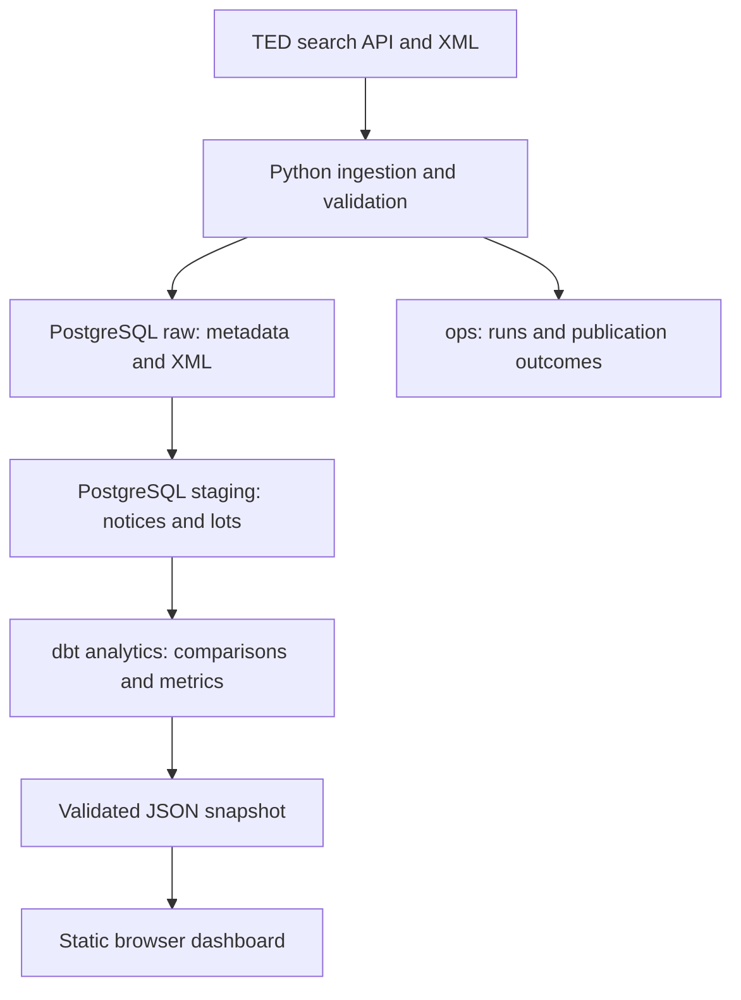

# Tender Intelligence Pipeline

Track submission deadline changes in Polish IT procurement notices from [TED](https://ted.europa.eu/). The pipeline collects publications, follows their explicit predecessor references, and compares deadlines for corresponding procurement lots. A searchable dashboard helps a bid team inspect changes and open the original notices.

**Stack:** Python 3.13 · pandas · PostgreSQL 16 · dbt Core · Docker Compose · JavaScript · GitHub Actions

## Data flow



- Incremental ingestion revisits an overlapping publication window; unchanged, successfully processed XML is skipped.
- Predecessors are resolved by publication number or notice UUID and version. History retrieval follows missing links in bounded batches.
- Notice and lot writes are atomic. Conflicting timezone offsets remain visible as quality issues instead of guessed timestamps.
- A single refresh command runs ingestion, history retrieval, dbt and export. The previous dashboard snapshot is retained if a pre-publication step fails.

**Current status:** local refresh, validated ZIP packaging and explicit `gh-pages` publication are implemented. GitHub Pages hosting configuration is separate. Earlier full refreshes were verified on Windows and Ubuntu 26.04 under WSL2; CI runs on Ubuntu 24.04.

## Run on another computer

<details>
<summary>Installation: Windows and Linux</summary>

Install Git, **Python 3.13**, Node.js **24**, and Docker with a Compose version supporting `!override` (verified with Compose 5.6.1). Start Docker. Commands below run from the repository root; use native Linux tools when working in WSL.

```bash
git clone https://github.com/JakLit00/tender-intelligence-pipeline.git
cd tender-intelligence-pipeline
```

Create environments and copy the configuration:

| Windows PowerShell | Linux Bash |
| --- | --- |
| `py -3.13 -m venv .venv` | `python3.13 -m venv .venv` |
| `py -3.13 -m venv .venv-dbt` | `python3.13 -m venv .venv-dbt` |
| `Copy-Item .env.example .env` | `cp .env.example .env` |
| `.\.venv\Scripts\Activate.ps1` | `source .venv/bin/activate` |

If PowerShell blocks activation, use `.\.venv\Scripts\python.exe` in place of `python` below. Linux may require the distribution's venv support package. Virtual environments must be created separately on each OS.

```bash
python -m pip install --upgrade "pip>=26.2"
python -m pip install -e ".[dev]"
```

Install dbt in its separate environment:

```powershell
# Windows
.\.venv-dbt\Scripts\python.exe -m pip install --upgrade "pip>=26.2"
.\.venv-dbt\Scripts\python.exe -m pip install -r requirements-dbt.txt
npm.cmd ci
```

```bash
# Linux
.venv-dbt/bin/python -m pip install --upgrade "pip>=26.2"
.venv-dbt/bin/python -m pip install -r requirements-dbt.txt
npm ci
```

Edit `.env`: replace password placeholders with separate local passwords for the admin, app, dbt and reporting roles. Keep the supplied database/user names. `DBT_TEST_DB_PASSWORD` must match the test override's dbt password when running tests. Never commit `.env`.

```bash
docker compose up -d --wait postgres
python scripts/refresh_dashboard.py --initial-date 2026-10-20
python -m http.server 8000 --bind 127.0.0.1 --directory dashboard
```

Open **http://127.0.0.1:8000**. Stop the preview with `Ctrl+C`. The initial refresh starts with an empty database and can take several minutes. If the bounded history limit is reached, inspect the error and rerun; already stored progress is retained.

The working database uses `127.0.0.1:5434`; tests use `5435`. Check for conflicts before starting. Initialization SQL runs only on a new database volume: changing `.env` does not change existing database passwords. Do not delete a populated volume to apply a schema or credential change.

</details>

## Daily use and checks

With Docker running and the application environment active:

```bash
python scripts/refresh_dashboard.py
```

Run one refresh at a time. A successful run produces `dashboard/data/dashboard.json`, validates its [JSON contract](docs/dashboard-contract.md) and metrics against dbt, and logs run IDs. Cycles in successfully prepared predecessor history fail dbt build and prevent snapshot replacement. The snapshot is ignored by Git. Refreshing locally does not publish it online.

Backfill ranges must end before today in UTC. To retry parsing stored XML from a failed run, use `python scripts/retry_failed_processing.py --source-run-id 123`, replacing `123` with the actual run ID. This command makes no downloads. Missing XML is recorded as a failed item while the rest of the batch continues; rerun backfill/incremental to recover downloads, or `run_history.py` for predecessor retrieval. Retry runs do not extend incremental coverage.

For the test suite, install both Python environments and Node.js, then start the separate test database first. Integration tests also invoke dbt using a dedicated temporary test profile and run the real JavaScript validator; they do not load `.env`:

```bash
docker compose -p tender-intelligence-tests -f compose.yaml -f compose.test.yaml up -d --wait postgres
python -m pytest -q
python scripts/run_dbt.py build --target test
python -m ruff check src scripts tests
python -m ruff format src scripts tests --check
node --test tests/dashboard/*.test.mjs
npm run format:check
```

Use `npm.cmd` instead of `npm` if PowerShell blocks the npm script. Test database data is disposable. See [development notes](docs/development-notes.md) for validation scope, operational checks and troubleshooting.

## Package and publish the dashboard

After a successful refresh, build and inspect the local package:

```bash
python scripts/build_dashboard.py
```

`dist/dashboard.zip` contains only `index.html`, `styles.css`, `app.js`, `analytics.mjs`, `contract.mjs`, `data/dashboard.json` and `.nojekyll`. The builder validates the copied JSON before atomically replacing an older ZIP. It neither refreshes the database nor publishes anything. Check the snapshot generation time, scope and public fields; validation cannot establish that source data is fresh.

Publication requires a clean Git working tree, configured `user.name`/`user.email`, and Git credentials with access to **JakLit00/tender-intelligence-pipeline**. The destination is fixed in `scripts/publish_dashboard.py`; it is not inferred from a fork's `origin`. Commit reviewed code changes before publication; the generated JSON and ZIP remain ignored.

```bash
python scripts/publish_dashboard.py
```

This is a **dry run**. It rebuilds the ZIP, contacts GitHub, reads the existing `gh-pages` branch, creates a temporary local deployment commit and executes `git push --dry-run`. It does not change the remote branch. It may require authentication and updates the local ZIP.

Only when intentionally publishing, run:

```bash
python scripts/publish_dashboard.py --publish
```

This invocation rebuilds the package again; it does not publish an immutable artifact approved by the previous dry run. Keep the snapshot and assets unchanged between review and publication. A normal push appends to existing history, skips identical content and rejects concurrent remote updates. Unexpected tracked files on `gh-pages` stop publication. Failures identify the Git operation and a safe diagnostic category without echoing credential-bearing stderr.

The script pushes assets to `gh-pages`; it does not configure GitHub Pages. Serving them requires repository Pages settings to use that branch and its root directory. A successful push alone does not verify the hosted site. CI performs tests and has no deployment step.

## Reading the results

A row represents a **publication–lot observation**, not a unique tender or an active opportunity. The extension rate counts extensions among comparable deadline pairs; missing and unreliable timestamps are excluded from that denominator and reported separately. History-only publications support comparisons but do not enlarge the selected reporting cohort.

Read [business logic](docs/business-logic.md) for scope, formulas and limitations, and [development notes](docs/development-notes.md) for implementation decisions. Always verify bidding requirements and current deadlines in the original TED notice and procurement documents.

## License

Project code is licensed under the [MIT License](LICENSE).
TED source data remains subject to its applicable reuse terms.
