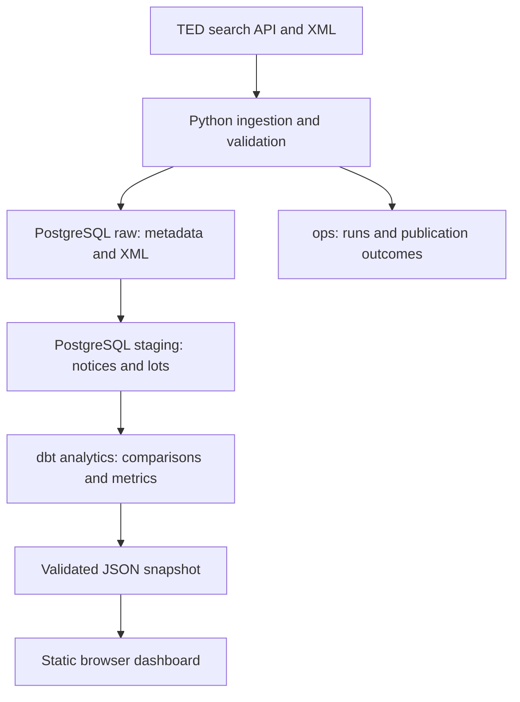

# Tender Intelligence Pipeline

[](https://github.com/JakLit00/tender-intelligence-pipeline/actions/workflows/ci.yml)
[](https://www.python.org/downloads/)
[](LICENSE)
[](https://jaklit00.github.io/tender-intelligence-pipeline/)

Track submission deadline changes in Polish IT procurement notices from [TED](https://ted.europa.eu/). The pipeline collects publications, follows their explicit predecessor references, and compares deadlines for corresponding procurement lots. A searchable dashboard helps a bid team inspect changes and open the original notices.

**Stack:** Python 3.13 · pandas · PostgreSQL 16 · dbt Core · Docker Compose · JavaScript · GitHub Actions

## Data flow



- Incremental ingestion revisits an overlapping publication window; unchanged, successfully processed XML is skipped.
- Predecessors are resolved by publication number or notice UUID and version. History retrieval follows missing links in bounded batches.
- Notice and lot writes are atomic. Conflicting timezone offsets remain visible as quality issues instead of guessed timestamps.
- A single refresh command runs ingestion, history retrieval, dbt and export. The previous dashboard snapshot is retained if a pre-publication step fails.

**Live on GitHub Pages:** the public dashboard shows the latest published snapshot and remains available when the local database is switched off. Updates are published manually after a successful local refresh. Earlier full refreshes were verified on Windows and Ubuntu 26.04 under WSL2; CI runs on Ubuntu 24.04.

**Verified in use:** a manual refresh and publication trial spanning 5–10 November 2026 produced four validated snapshots, growing from 204 notices / 401 lot observations to 250 / 480. See [validation evidence](docs/development-notes.md#validation-evidence-and-boundaries).

## Run on another computer

<details>
<summary>Installation: Windows and Linux</summary>

Install Git, **Python 3.13**, Node.js **24**, and Docker with a Compose version supporting `!override` (verified with Compose 5.6.1). Start Docker. Commands below run from the repository root; use native Linux tools when working in WSL.

```bash
git clone https://github.com/JakLit00/tender-intelligence-pipeline.git
cd tender-intelligence-pipeline
```

Create environments and copy the configuration:

| Windows PowerShell | Linux Bash |
| --- | --- |
| `py -3.13 -m venv .venv` | `python3.13 -m venv .venv` |
| `py -3.13 -m venv .venv-dbt` | `python3.13 -m venv .venv-dbt` |
| `Copy-Item .env.example .env` | `cp .env.example .env` |
| `.\.venv\Scripts\Activate.ps1` | `source .venv/bin/activate` |

If PowerShell blocks activation, use `.\.venv\Scripts\python.exe` in place of `python` below. Linux may require the distribution's venv support package. Virtual environments must be created separately on each OS.

```bash
python -m pip install --upgrade "pip>=26.2"
python -m pip install -e ".[dev]"
```

Install dbt in its separate environment:

```powershell
# Windows
.\.venv-dbt\Scripts\python.exe -m pip install --upgrade "pip>=26.2"
.\.venv-dbt\Scripts\python.exe -m pip install -r requirements-dbt.txt
npm.cmd ci
```

```bash
# Linux
.venv-dbt/bin/python -m pip install --upgrade "pip>=26.2"
.venv-dbt/bin/python -m pip install -r requirements-dbt.txt
npm ci
```

Edit `.env`: replace password placeholders with separate local passwords for the admin, app, dbt and reporting roles. Keep the supplied database/user names. `DBT_TEST_DB_PASSWORD` must match the test override's dbt password when running tests. Never commit `.env`.

```bash
docker compose up -d --wait postgres
python scripts/refresh_dashboard.py --initial-date 2026-10-20
python -m http.server 8000 --bind 127.0.0.1 --directory dashboard
```

Open **http://127.0.0.1:8000**. Stop the preview with `Ctrl+C`. The initial refresh starts with an empty database and can take several minutes. If the bounded history limit is reached, inspect the error and rerun; already stored progress is retained.

The working database uses `127.0.0.1:5434`; tests use `5435`. Check for conflicts before starting. Initialization SQL runs only on a new database volume: changing `.env` does not change existing database passwords. Do not delete a populated volume to apply a schema or credential change.

</details>

## Daily use

From the project root, with Docker running and the application environment active:

```bash
docker compose up -d --wait postgres
python scripts/refresh_dashboard.py
```

Run one refresh at a time. Success produces a validated local JSON snapshot and logs run IDs and counts. After the refresh succeeds and you inspect the data, publish separately:

```bash
python scripts/publish_dashboard.py --publish
```

Publication requires repository write access and a clean Git working tree. If refresh fails, stop before publishing: the previous valid snapshot may still exist. See [development notes](docs/development-notes.md#daily-operating-procedure) for review checks, packaging, dry runs, publication and troubleshooting.

## Reading the results

A row represents a **publication–lot observation**, not a unique tender or an active opportunity. The extension rate counts extensions among comparable deadline pairs; missing and unreliable timestamps are excluded from that denominator and reported separately. History-only publications support comparisons but do not enlarge the selected reporting cohort.

Read [business logic](docs/business-logic.md) for scope, formulas and limitations, and [development notes](docs/development-notes.md) for implementation decisions. Always verify bidding requirements and current deadlines in the original TED notice and procurement documents.

## License

Project code is licensed under the [MIT License](LICENSE).
TED source data remains subject to its applicable reuse terms.
