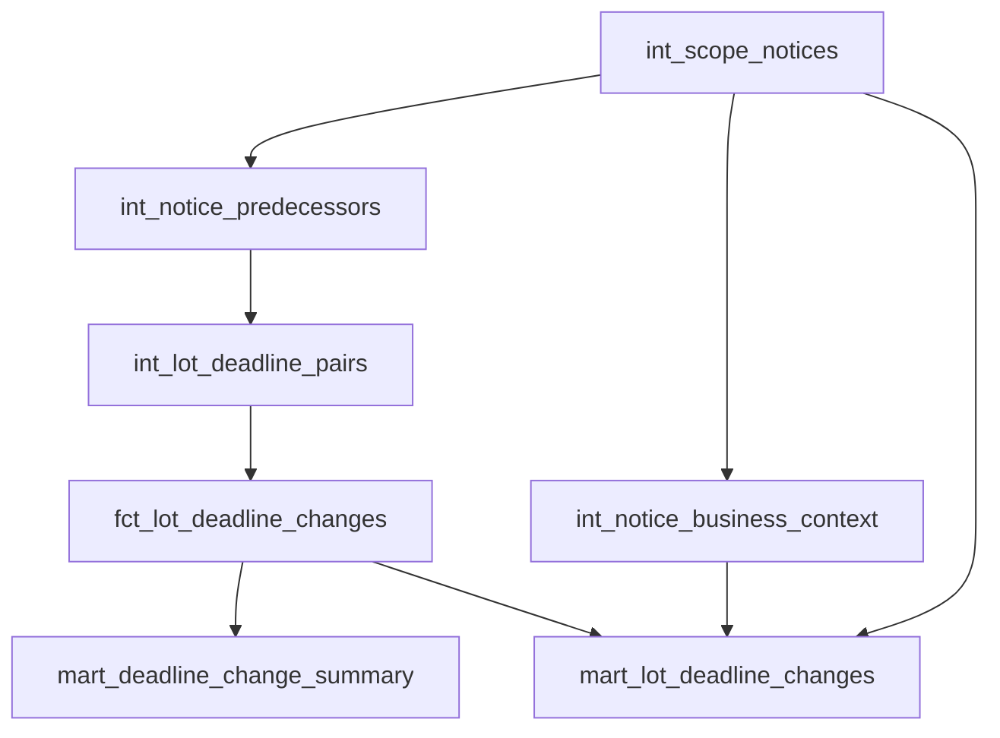

# Development Notes

## Purpose and development sequence

This document records implementation decisions and operational knowledge. It describes the implemented system rather than a future feature list. Publication tooling is implemented; repository hosting settings and a live deployment require separate verification.

1. **Inspect real TED data.** Examine search metadata and XML before defining the relational model. Distinguish publication numbers, notice UUIDs, versions, procedures and lot identifiers. Verify submission deadline paths with real change chains.
2. **Build preparation functions.** Separate extraction from normalization and business classification. Cover publication-number references and UUID-version references with focused tests.
3. **Introduce PostgreSQL storage.** Separate operational tracking, source payloads and prepared entities. Add constraints and integration tests before connecting a larger ingestion run.
4. **Implement ingestion and history.** Add pagination, pandas-based search-result preparation, XML download and repeatable processing. Resolve missing predecessors in bounded batches.
5. **Exercise real failures.** A run with 132 publications initially failed for ten publications because deadline dates and times contained conflicting offsets. Preserve those observations with a quality flag and no exact deadline instead of discarding them or inventing a timezone. Retry successfully processed all ten; twelve lots carried the conflict flag.
6. **Add incremental coverage.** Use successful coverage and an overlap window, rather than simply selecting the largest observed publication date. Repeated runs skip unchanged prepared payloads.
7. **Build dbt analytics.** Resolve predecessor matches, pair lots, classify deadline changes and calculate summary metrics. Enrich reporting with notice titles, buyer names and TED links.
8. **Build the static dashboard and refresh command.** Export with a read-only role, support filtering and details in the browser, and validate JavaScript metrics against dbt before replacing the snapshot.
9. **Standardize quality and verify portability.** Add Ruff and Prettier checks to CI. Verify a complete refresh from an empty, isolated database on Ubuntu under WSL2 in addition to Windows operation.

## Storage and transformations

| Layer | Responsibility |
| --- | --- |
| `ops.pipeline_runs` | Run mode, date window, timing, completion status and error context. |
| `ops.run_notices` | Publication outcomes associated with each run. |
| `raw.notices` | Search metadata, original XML, discovery flags and processing state. |
| `staging.notices` | Prepared identities, publication dates and predecessor references. |
| `staging.notice_lots` | Lot-level deadline source values, normalized values and quality flags. |
| `analytics` | dbt views serving comparisons, business context and reporting. |



The diagram shows the main model dependencies; source tables also provide the prepared notices, lots and metadata used by these models. Views keep the small analytical layer transparent and avoid introducing incremental dbt materialization before it is needed.

## Key decisions and tradeoffs

**Python and pandas.** Python owns networking, parsing, validation and orchestration. pandas prepares tabular search results, including publication-number normalization, date handling and uniqueness checks. XML traversal and transactional writes do not require DataFrames. SQL/dbt owns analytical joins and metrics.

**Identity before convenience.** UUID-version references are supported alongside publication numbers. A procedure ID groups related publications but is not a substitute for an explicit predecessor link. Matching requires checks for ambiguity, self-reference and procedure consistency.

**Atomic prepared writes.** Notice and lot changes belong in one transaction. If any part fails, rollback prevents a partially updated prepared record. Raw payloads and processing errors retain diagnostic context. Analytics selects successfully prepared data.

**Repeatability.** Unchanged XML already processed successfully is skipped. Failed payloads remain eligible for retry. This limits duplicate work but does not make the entire multi-stage refresh one database transaction.

**History boundaries.** A history run processes a bounded selection of unresolved references. Both referring notices and candidate predecessors must have `raw.processing_status = 'succeeded'`; retained staging rows for pending/failed XML do not count as prepared. History-only notices remain eligible to reveal deeper links, while the reporting cohort still requires scope-search discovery. Newly discovered predecessors may themselves refer to older notices, so several batches can be required. The refresh orchestrator checks remaining work, detects lack of progress and enforces a batch limit. The `no_predecessor_cycles` dbt test checks all eligible history, including self-references and UUID-version links. A cycle makes build fail and prevents refresh from replacing the snapshot; the SQL diagnostic also remains available for inspection.

**Incremental coverage.** Successful backfill/incremental coverage determines the next search window, with overlap to revisit recent publications. Retry/history runs are not substitutes for complete date-window ingestion. Overlap reduces missed late changes but does not guarantee discovery of every arbitrarily late correction; a historical backfill remains necessary in that situation.

Backfill rejects ranges ending today or later in UTC, both in the CLI and in the domain function before creating a run. Previously recorded invalid coverage is not rewritten automatically. If an older run claimed incomplete/future days, review that run before explicitly correcting its coverage record; a new successful run does not invalidate the old one.

**Retry and network limits.** `retry_failed_processing.py --source-run-id ID` retries failed items using stored XML. It rejects unfinished and history source runs. A missing XML item remains failed with download guidance; other items continue. Source outcomes are retained. Backfill/incremental recover downloads, and history retrieval is retried through `run_history.py`. The TED client allows three attempts for selected HTTP failures and transient transport failures (timeouts, connection interruptions/refusals, temporary DNS and incomplete bodies), with backoff. Certificate errors, permanent DNS errors and unclassified failures are not retried. Retry-After values above the configured delay limit stop the request. Each response is limited to 20 MiB of actually read bytes, regardless of Content-Length; an oversized response fails without retry.

**Timezone conflicts.** The source can supply a date ending in `Z` and a time with a different offset. The system does not silently favor one. Local date, raw values and a quality issue remain available, while exact comparison is withheld.

**Separate reporting role.** The exporter connects as `tender_reporter`, with SELECT access to analytics. Default privileges for models created by `tender_dbt` preserve this access when models are recreated. Application, dbt and reporting credentials are separate.

**Consistent export.** Summary, scope and detail rows are read in a repeatable-read, read-only transaction. Serialization handles dates, UTC timestamps, decimals and UUIDs; unsupported values fail explicitly. A candidate JSON file is checked before same-filesystem replacement of the final snapshot.

The shared [dashboard contract](dashboard-contract.md) rejects missing/unknown fields, invalid types and dates, inconsistent statuses and duplicate publication-lot pairs. It also recalculates summary metrics. It runs in refresh, ZIP building and the browser; contract validation is not a freshness guarantee. The standalone `export_dashboard.py` writes JSON without invoking Node; validate that output before using it as a public snapshot.

**Static delivery.** HTML, CSS, JavaScript and JSON can present a frozen result without a running database or Python server in production. Browser code does not need database credentials. Local preview uses Python's HTTP server. GitHub Pages publication is a separate step, not an effect of ingestion.

**Lightweight orchestration.** One Python command is proportionate to this manually operated portfolio pipeline. It runs configuration checks, ingestion, history, dbt, export and metric validation sequentially. There is no scheduler or concurrent-run lock; operate one refresh at a time.

## Validation evidence and boundaries

At the code-quality checkpoint, the local Python suite reported **304 passed**, dashboard tests **7 passed**, and dbt build **PASS=35** (7 views, 27 data tests and 1 unit test). These are recorded results, not permanent expected counts.

The GitHub Actions workflow uses Ubuntu 24.04 and installs Python, Node.js, application dependencies and dbt from a clean checkout. It starts an isolated PostgreSQL test service, runs Python and dashboard tests, builds/tests dbt and checks Ruff/Prettier. The workflow does not run the full live TED ingestion scenario.

A full live refresh on **5 November 2026** succeeded on Ubuntu 26.04 under WSL2 with Python 3.13.18. It produced **204 scope publications and 401 lot observations**, completed dbt with PASS=35 and matched every exported summary metric against the JavaScript implementation. Windows had produced the same cohort counts earlier that day. Equal counts alone are not proof of byte-identical datasets.

Mocked orchestration tests exercise stage failures and preservation of the previous snapshot. Database integration tests exercise actual transactions and constraints. dbt unit tests use controlled inputs to check classification; data tests check built relations. Passing tests do not constitute a complete security audit or a guarantee of source completeness.

Integration tests now build dbt views using a temporary profile fixed to the test database, exercise a nonempty SQL → reporting-role export → real JavaScript validator flow, reject cycles through real dbt build, and check denied role permissions. Install `.venv-dbt` and Node before running them. Publisher tests use temporary local bare remotes and cover dry runs, history preservation, malformed ZIPs, unexpected branch files, concurrent updates and safe diagnostics. They never contact the real publishing remote.

## Fresh setup and environment isolation

Follow the [README](../README.md) for installation. Python is constrained to `>=3.13,<3.14`; an installed Python 3.14 does not satisfy that declaration. Create `.venv` for the application and `.venv-dbt` for dbt using Python 3.13. Windows environments cannot be reused on Linux.

The WSL verification used a separate checkout in the Linux filesystem, separate native Python/Node installations and a Compose project named `tender-intelligence-linux-check`, with port 5436 and its own volume. These were isolation measures for the existing development machine, not additional requirements for a new user.

Normal working and test databases use ports 5434 and 5435. `docker compose -p ...` selects the project; a port override is also necessary when starting a second working database on the same Docker engine. Test overrides use `!override` so ports are replaced rather than appended.

SQL files in `sql/init/` initialize a fresh volume. They are not an automatic migration runner for an existing volume. Apply reviewed changes explicitly to existing databases and keep fresh initialization equivalent. Changing an environment password alone does not update the corresponding existing PostgreSQL role.

## Daily operating procedure

1. Start Docker and the working PostgreSQL service; verify it is healthy.
2. Activate the application environment and ensure native Node.js is on PATH.
3. Run `python scripts/refresh_dashboard.py` once and wait for completion.
4. Check the final success message, run IDs, cohort counts and metric validation. Inspect failures rather than treating partial ingestion as successful publication.
5. Open the local dashboard; check generation time, date range, filters and a sample TED detail link. Counts can remain unchanged on a day with no matching publications.
6. Record any operational findings. Do not claim public data has refreshed merely because local export succeeded.

To inspect recent runs:

```sql
SELECT run_id, run_mode, date_from, date_to, status,
       started_at, finished_at, error_message
FROM ops.pipeline_runs
ORDER BY run_id DESC
LIMIT 10;
```

Diagnostic scripts `scripts/check_predecessor_matches.sql`, `scripts/check_missing_predecessors.sql` and `scripts/check_predecessor_cycles.sql` help distinguish absent references, unavailable referenced notices and cycles. Inspect their results after changes to history handling or when investigating unexpected comparisons.

## Failure handling and troubleshooting

| Symptom | Check or action |
| --- | --- |
| Docker connection fails | Start Docker and confirm the intended context and engine. |
| Port already allocated | Inspect existing containers; choose an isolated override rather than stopping unrelated projects. |
| Role authentication fails after editing `.env` | Existing role passwords have not changed automatically. Apply an explicit credential update or use the correct original local credentials. |
| dbt executable missing | Install `requirements-dbt.txt` inside `.venv-dbt` for the current OS. |
| Node missing in WSL but npm exists | Check both executable paths; Windows npm on PATH is not a native Linux Node installation. |
| History batch limit reached | Review progress and unresolved links; rerun to continue, or deliberately adjust the limit after inspection. |
| Refresh fails after ingestion | Database progress may already be committed; the previous final JSON remains until a successful validated replacement. Fix the failed stage and rerun. |
| Dashboard fetch fails when opening an HTML file | Serve the dashboard through the local HTTP preview command, not `file://`. |
| Tests import two modules with the same basename | Use distinct test module names or an intentional package/import configuration. |
| dbt dependency download fails with HTTP 504 | Distinguish an external installation failure from a test failure; inspect the failing step before rerunning. |

Do not run `docker compose down --volumes` on the working project as routine cleanup. It removes stored data. The test configuration is disposable; scope cleanup commands to the intended test project.

## Repository practice and remaining release work

Feature branches and pull requests keep changes reviewable. CI checks precede merging; merge commits preserve feature boundaries. Ruff handles Python import ordering, linting and formatting. Prettier formats dashboard HTML/CSS/JavaScript. Neither is a security scanner.

Secrets, local payloads, generated snapshots and virtual environments stay out of Git. The current static UI creates text content through DOM APIs and constructs TED links from publication identifiers; these choices still require review alongside dependency, export and workflow configuration.

The [README publication procedure](../README.md#package-and-publish-the-dashboard) describes local building, networked dry runs and explicit publication. The publisher uses a fixed repository URL, preserves branch history and refuses unexpected files. It does not configure Pages, refresh data or prove that a hosted deployment succeeded. Verify the final payload and hosting independently, and observe several daily refreshes before claiming an operational trial.

The audit fixes require no table or role migration. Deploy the Python/JavaScript changes together and run the normal dbt build to execute the additional cycle check. Review any existing failed source records or previously invalid coverage separately; no automatic repair of historical operational records is performed.

Actions are pinned to commits verified against the official repositories. Full Python dependency locking and a lightweight Windows CI job remain separate proposals; neither is introduced by these fixes.
